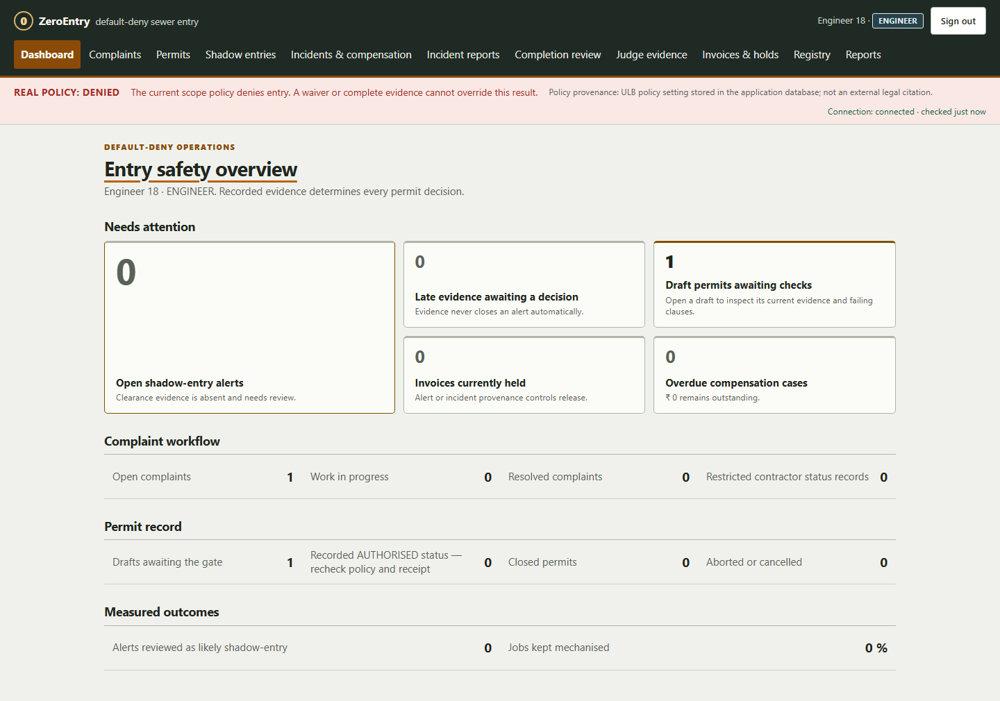
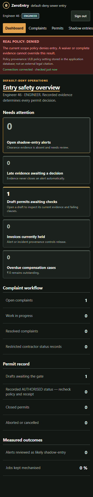

# ZeroEntry
### Mechanised first. Evidence before permission. Accountability after closure.

**A database-first sanitation-safety and municipal work-evidence prototype.**
Built for **DBThon 2026 · VIT SCOPE · Database Systems / BCSE302P**.

ZeroEntry connects municipal complaints, mechanised work, exceptional entry decisions, worker participation,
completion evidence and incident review in one auditable relational workflow. PostgreSQL enforces the rules;
the interface explains them.

[Start locally](#quick-start) · [Project tour](docs/PROJECT_TOUR.md) · [Judge walkthrough](docs/development/DEMO_SCRIPT.md) ·
[Full ER diagrams](docs/ER_DIAGRAM.md) · [Measured evidence](docs/EVALUATION.md)

> **Prototype, not field permission.** Real or unknown jurisdiction policy fails closed.
> Positive manual-entry decisions are explicitly **EDUCATIONAL** simulations.
> Missing records trigger review; they do not prove physical entry, fraud or wrongdoing.
> All screenshots and demo records are synthetic.

## The gap we address

A completed complaint is not the same as proven safe work. A worker assigned to a permit is not necessarily a worker
who acknowledged participation. A passing preview may become stale before admission. An incident victim may have no
registry ID at all.

Electronic permits, gas checks, triggers and worker registries already exist. Our contribution is their **bounded,
database-enforced municipal integration**, with explicit handling of these gaps—not a claim to have invented those
individual techniques.

| Gap | ZeroEntry's response |
|---|---|
| A waiver or complete PPE checklist is mistaken for legal eligibility | Separate jurisdiction policy from operational evidence; real/unknown scope requires review |
| Assigned crew and actual participants are conflated | Each crew member acknowledges their own participation; distinct entrant/standby/supervisor roles |
| Personal equipment passes while shared rescue resources are missing or double-booked | Separate personal/shared serial assets, current readiness, and exclusive person/asset reservations |
| Evidence changes after a green preview | Lock evidence during the decision; retain revision/expiry receipts; recheck on admission |
| A complaint closes without accountable work evidence | Complaint-anchored absence detection, receipt-time grace rules and human review |
| Late uploads silently erase the discrepancy | Retain alerts and review history; release only the relevant source-linked invoice hold |
| A victim cannot be recorded without an existing worker/job/permit | Standalone multi-victim intake with optional registry links and pending assessments |
| A dropped response causes duplicate writes or missed updates | Transactional exact-key retries and durable, scope-ordered event replay |

Read the [prior-art and policy comparison](docs/POLICY_AND_PRIOR_ART.md) for sources and limits.

## How the system works

~~~mermaid
flowchart LR
    C["Municipal complaint"] --> J["Job and contractor"]
    J --> M["Mechanised attempt"]
    M -->|Cleared| E["Completion evidence"]
    M -->|Failed with recorded justification| W["Engineer waiver"]
    W --> D["DRAFT permit"]
    D --> G{"PostgreSQL decision gate"}
    P["Jurisdiction policy"] --> G
    S["Crew acknowledgment · gear · readiness · gas"] --> G
    G -->|Any clause fails| R["Retained denied receipt"]
    G -->|All pass in educational scope| A["AUTHORISED + immutable receipt"]
    A --> I["Current admission check + entry/exit logs"]
    I -->|Adverse or expired evidence| X["ABORTED · preserve truthful exits"]
    I -->|All people out and closed| E
    C --> V["Closure / imported-claim reconciliation"]
    E --> V
    V -->|Expected evidence absent or late| H["Human review + source-linked hold"]
~~~

### Three layers, one authority

~~~mermaid
flowchart TB
    UI["Browser UI ES modules · light/dark · responsive · accessible tabs"]
    API["FastAPI Session authentication · CSRF · role/scope guards Request transaction · parameterized SQL"]
    DB[("PostgreSQL 16 Constraints · PL/pgSQL functions/procedures · triggers · RLS Evidence · decisions · audit · command receipts · outbox")]
    SW["Periodic maintenance Safety sweep · absence scan · completion projection"]
    UI -->|"Authenticated requests / event replay"| API
    API -->|"Least-privilege ze_app role"| DB
    SW -->|"Separate database transactions"| DB
~~~

Business rules live in PostgreSQL, not only in buttons or Python validators. The runtime role cannot rewrite audit
history or administer the schema. Raw runtime writes still encounter database guards. Database owners remain trusted;
this is not tamper-proof against an administrator.

**Stack:** Python 3.11/3.12 · FastAPI · SQLAlchemy mappings · Psycopg · Alembic · PostgreSQL 16 / PL/pgSQL ·
plain HTML/CSS/JavaScript. No frontend build step, CDN or Docker is needed for the local demo.

## ER diagram

A readable overview of selected **real foreign-key relationships** is shown below. It deliberately omits most columns
and identity/audit links; it is not the complete schema. The [full ER diagrams](docs/ER_DIAGRAM.md) are checked against the
database, and the generated [schema reference](docs/SCHEMA_REFERENCE.md) contains all **50 tables and 97 foreign keys**.

~~~mermaid
erDiagram
    ulb ||--o{ manhole : contains
    manhole ||--o{ complaint : receives
    complaint ||--o{ job : generates
    contractor ||--o{ job : undertakes
    contractor ||--o{ worker : employs
    job ||--o{ machine_deployment : records
    job ||--o| mechanisation_waiver : justifies
    job ||--o{ entry_permit : requires
    entry_permit ||--o{ permit_crew : assigns
    worker ||--o{ permit_crew : participates
    permit_crew ||--o{ gear_issue : receives
    gear_asset |o--o{ gear_issue : identifies
    entry_permit ||--o{ permit_site_gear : shares
    gear_asset ||--o{ permit_site_gear : identifies
    entry_permit ||--o{ permit_readiness : documents
    entry_permit ||--o{ gas_reading : observes
    entry_permit ||--o{ permit_decision_receipt : retains
    permit_crew ||--o{ entry_log : records
    complaint ||--o{ shadow_entry_alert : reviews
    job ||--o{ invoice : bills
    invoice ||--o{ invoice_hold : restricts
    shadow_entry_alert |o--o{ invoice_hold : originates
    job |o--o{ completion_claim : optionally_matches
    ulb ||--o{ incident_report : scopes
    incident_report ||--o{ incident_report_victim : includes
    worker |o--o{ incident_report_victim : optionally_identifies
    incident_report_victim ||--o| incident_assessment_case : opens
~~~

### Database systems concepts, used together

| Syllabus area | Working application |
|---|---|
| **LAB 1 — DDL / DML** | Forward-only schema migrations, normalized entities, deterministic synthetic seeds |
| **LAB 2 — Constraints** | PK/FK, CHECK/UNIQUE, composite crew keys, overlap exclusion, cross-row trigger checks |
| **LAB 3 — Scalar functions** | Time/freshness boundaries and reproducible SQL demonstrations |
| **LAB 4 — Operators / aggregates** | Municipal reports, zero-entry rates and contractor review metrics |
| **LAB 5 — Queries / joins / views** | Relational division for every required safeguard; anti-joins for missing expected evidence |
| **LAB 6 — Database programming** | PL/pgSQL gate functions, atomic incident procedures, refusal/audit triggers, explicit OPEN/FETCH/CLOSE cursor |
| **Theory in practice** | ER-to-relational modeling, functional dependencies/3NF, transactions, locks/concurrency, indexes/query plans, RLS and recovery checks |

PostgreSQL uses **PL/pgSQL**, not Oracle PL/SQL, and has no native CREATE ASSERTION. The lab demonstration explains
the cross-row constraint-trigger alternative instead of claiming unsupported syntax.
See the [rubric-to-evidence map](docs/SUBMISSION.md) and the in-app **Judge evidence** screen.

## Quick start

Use **Python 3.11 or 3.12**. The development dependency starts an embedded PostgreSQL 16 instance; a separate
PostgreSQL installation is not required. For Python 3.13+ or an external server, read [SETUP](docs/SETUP.md).

### Windows PowerShell

~~~powershell
git clone https://github.com/SohamGeniusCoder/ZeroEntry.git
cd ZeroEntry
py -3.12 -m venv .venv
.venv\Scripts\python.exe -m pip install -e ".[dev]"
.venv\Scripts\python.exe scripts/dev.py --data-dir .pgdata/dbthon-ze2 --port 8000
~~~

Use `py -3.11` instead if that is your installed version. No activation-policy change is needed.

### macOS / Linux

~~~bash
git clone https://github.com/SohamGeniusCoder/ZeroEntry.git
cd ZeroEntry
python3.12 -m venv .venv
.venv/bin/python -m pip install -e ".[dev]"
.venv/bin/python scripts/dev.py --data-dir .pgdata/dbthon-ze2 --port 8000
~~~

Open **http://127.0.0.1:8000/**. Keep the terminal running.

Startup migrates and seeds the isolated development database and prints the **generated local demo password**.
Sign in with `supervisor@zeroentry.example` to see real-scope denial, or use an educational account for the
positive simulation. There is deliberately no published shared password.

| Account | Main purpose |
|---|---|
| `admin@zeroentry.example` | Users, policy parameters, governed allocations, audit |
| `engineer@zeroentry.example` | Complaints/jobs, mechanisation, waivers, completion and alert review |
| `supervisor@zeroentry.example` | Permit evidence, decisions, entries/exits, stop/close |
| `worker@zeroentry.example` | Own crew participation and stop-work |
| `contractor@zeroentry.example` | Own scoped work and invoices |
| `auditor@zeroentry.example` | Read-only oversight and reports |

Educational rehearsals use `edu_engineer@zeroentry.example`, `edu_supervisor@zeroentry.example` and
`edu_worker_1@zeroentry.example` through `edu_worker_4@zeroentry.example`.
Use the accounts printed by startup; the generated password is kept only in the ignored local database directory.

**Already running on your machine?** Do not reset its database. Visit the existing server, or choose `--port 8001`
for another instance. These are localhost development instructions, not a production deployment guide.

## See the features in five minutes

In a **second terminal**, while the server runs:

~~~powershell
.venv\Scripts\python.exe scripts/prepare_demo.py --url http://127.0.0.1:8000
~~~

Enter the generated password at the hidden prompt. The helper creates a new educational DRAFT through the normal
authenticated API and prints the record IDs. It leaves one worker acknowledgment missing; it does **not** authorize
entry or change real jurisdiction policy.

1. Show the ordinary supervisor's **real-scope denial** and retained negative receipt.
2. Open the educational draft. Show why **assignment without acknowledgment** fails.
3. As the fourth educational worker, acknowledge only their own participation. Retry and inspect the actual
   decision, revision and expiry; address any other failed clauses honestly.
4. Record a simulated entry, then adverse simulated gas. Permission stops, but the person remains recorded inside
   until an honest exit is entered. ABORTED permits cannot be reopened.
5. Review an imported completion claim and missing expected evidence. Explain grace windows and source-linked holds.
6. Record a standalone report with two unregistered victims. Show **pending assessments, not paid compensation**.
7. Open Judge evidence and connect the working features to the syllabus and measured tests.

Prepare shortly before presenting: gas and readiness evidence expire. Daylight is a configured educational proxy;
the [detailed demo script](docs/development/DEMO_SCRIPT.md) explains legitimate rehearsal limits and backup SQL demonstrations.

<strong>Mobile / dark-mode preview</strong>

The integrated frontend preserves the teammate's operations-board style, with responsive navigation, keyboard tabs,
policy labels, receipt/reconciliation screens and the existing safety workflow.

## Verification — evidence, not promises

The final frontend-integrated source has a recorded local full-suite result of **620 passed, including six Chromium
browser scenarios, with zero failures, errors or skips**. Inspect the
[source-bound manifest](docs/evidence/current.json), [actual JUnit report](docs/evidence/integration.xml) and
[run/source binding](docs/evidence/integration.source.json).

The suite tests real PostgreSQL behavior, authenticated role/scoping restrictions, races, rollback, retries and selected
browser workflows. Six browser scenarios do **not** mean every screen or physical outcome has been validated.

To reproduce a complete verification:

~~~powershell
.venv\Scripts\python.exe -m pip install -e ".[dev,browser]"
.venv\Scripts\python.exe -m playwright install chromium
.venv\Scripts\python.exe scripts/verify_release.py --workers 4
~~~

GitHub Actions is configured for Linux/Windows Python 3.11/3.12, macOS Python 3.12, PostgreSQL 16 and a Chromium job.
**Configured CI is not a claim that the newly published repository's remote run has passed.**
[Check the actual runs](https://github.com/SohamGeniusCoder/ZeroEntry/actions).

Synthetic evaluations include current 1,000- and 10,000-complaint runs, receipt-time evidence comparisons,
database-enforcement ablations and a controlled stale-preview interleaving. Read the method and baseline caveats before
quoting an improvement. Older 100,000-row results are retained as historical evidence, not silently attributed to this UI release.

[Evaluation method](docs/EVALUATION.md) · [Generated results](docs/EVALUATION_RESULTS.md) ·
[Temporal experiment](docs/evaluation/RESULTS.md) · [Restore check](docs/evidence/restore.json)

## Explore the repository

| Location | What you will find |
|---|---|
| `database/migrations/` | 16 forward-only migrations: schema, PL/pgSQL and database policy |
| `database/queries/` | Annotated joins, aggregates, division/anti-joins, transactions, cursor and refusal demos |
| `database/seeds/` | Deterministic synthetic scenarios |
| `src/zeroentry/` | Authenticated API, mappings, maintenance, evidence and static browser UI |
| `tests/` | Unit, SQL behavior, API/role and selected browser regression tests |
| `scripts/` | Start, migrate, seed, prepare demo, generate docs, evaluate and verify |
| `docs/` | Specification support, diagrams, decisions, syllabus/rubric mapping and measured evidence |
| `.github/workflows/` | Cross-platform, PostgreSQL-service, package and browser checks |

### Documentation bookshelf

| Read | Purpose |
|---|---|
| [Project tour](docs/PROJECT_TOUR.md) | Plain-language explanation from complaint to review, with reasons for design choices |
| [Project specification](PROJECT_SPEC.md) | Stable business rules, roles and explicit assumptions |
| [Architecture](docs/ARCHITECTURE.md) / [Database design](docs/DATABASE_DESIGN.md) | Request lifecycle, normalized modeling, locking and trade-offs |
| [ER diagrams](docs/ER_DIAGRAM.md) / [Schema reference](docs/SCHEMA_REFERENCE.md) | Relationships and generated column/constraint details |
| [API reference](docs/API_SPEC.md) / [Security](SECURITY.md) | Endpoints, roles, sessions, RLS, controls and trust boundaries |
| [Setup](docs/SETUP.md) / [Testing](docs/TESTING.md) | Installation, troubleshooting and reproducible verification |
| [Submission](docs/SUBMISSION.md) / [Presentation brief](docs/development/PRESENTATION_BRIEF.md) | Rubric coverage, problem, novelty, SDG alignment and evidence caveats |
| [Demo script](docs/development/DEMO_SCRIPT.md) / [Release handoff](docs/development/ZE2_RELEASE.md) | Rehearsal and final integration status |
| [Integration guide](docs/development/INTEGRATION_GUIDE.md) / [Team plan](docs/plan/README.md) | Repository review and retained worker handoffs; historical alternatives are labelled |
| [Roadmap](ROADMAP.md) / [Development log](docs/development/DEV_LOG.md) | Current work and its history |

## Boundaries that matter

- Recorded evidence is not authenticated sensor truth, physical access prevention or a rescue service.
- Waivers, PPE and a green educational decision do not establish legal permission in a real jurisdiction.
- A receipt digest supports local integrity checking; it is not an externally signed certificate.
- Missing/late evidence and imported completion claims require human interpretation.
- Configured compensation amounts, holds and contractor statuses are internal prototype decisions, not legal awards or disbursements.
- The maintenance loop depends on API/database availability; outages can delay periodic checks.
- Laboratory validation uses synthetic data. No field certification, global-first claim or deaths-prevented statistic is made.

## Credits and contributing

This repository publishes the team's final integrated ZeroEntry work, including the teammate's operations-UI styling,
while retaining the original Git history. The project builds on the team's
[DBThon repository](https://github.com/Vyas-Vis06/DBThon-) and its database-first foundation.
Publication here does not merge into or rewrite that repository.

For changes, read [CONTRIBUTING](CONTRIBUTING.md) and [AGENTS](AGENTS.md). Add rules through new migrations, retain
passing **and** failing tests, and keep generated schema/API documents synchronized. Never commit passwords,
`.env`, local database directories or dumps.

**License:** No project-wide open-source license has been declared in this checkout. Public visibility alone is not
a license grant; obtain the authors' permission before reuse or redistribution.
